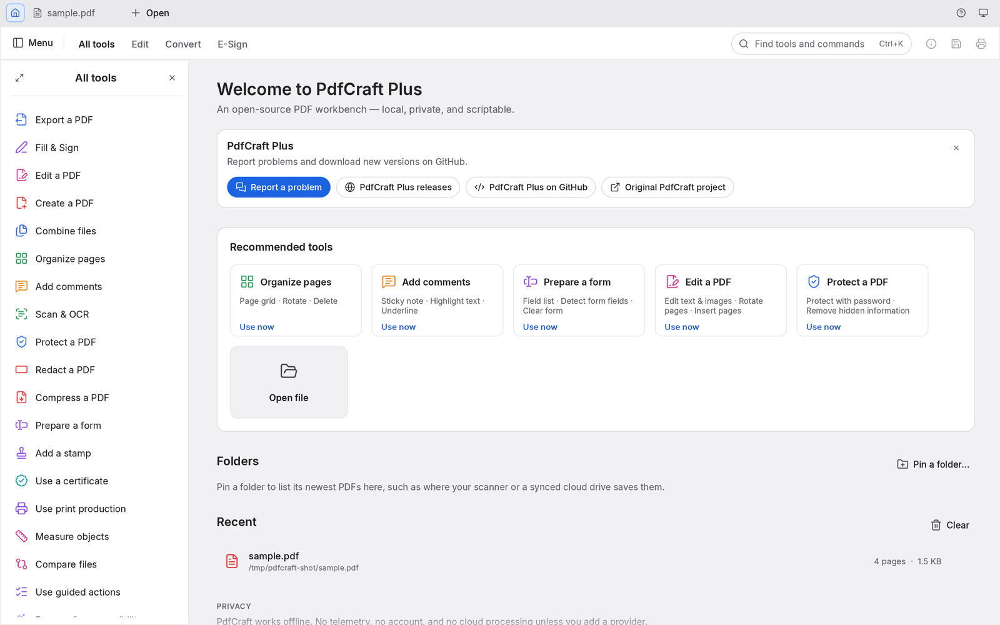

<p align="center">
  
</p>

<h1 align="center">PdfCraft Plus</h1>

<p align="center">
  <b>A personal fork of <a href="https://github.com/storytold/pdfcraft">PdfCraft</a>, the open-source PDF reader and editor written in pure Rust, with extra page layout and clean-up tools.</b><br>
  Ready-made builds for macOS 11 or later (Apple silicon and Intel)
</p>

<p align="center">
  
  
  
  
</p>

<br>

<p align="center">
  
  <br>
  <sub>The PdfCraft Showcase, a 13-page specimen PDF, open with the All tools panel and threaded comments.</sub>
</p>

<p align="center">
  <a href="#about-this-fork">About this fork</a> ·
  <a href="#install-on-macos">Install</a> ·
  <a href="#highlights">Highlights</a> ·
  <a href="#read-anything-beautifully">Read</a> ·
  <a href="#find-it-select-it-copy-it">Find</a> ·
  <a href="#organize-pages-like-cards-on-a-table">Organize</a> ·
  <a href="#combine-and-split-without-losing-a-thing">Combine &amp; split</a> ·
  <a href="#open-protected-documents-and-respect-their-rules">Protect</a> ·
  <a href="#comments-forms-layers-and-attachments">Forms &amp; layers</a> ·
  <a href="#runs-everywhere-stays-yours">Everywhere</a> ·
  <a href="#built-for-agents-too">Agents</a> ·
  <a href="#how-its-built">How it's built</a> ·
  <a href="#get-started">Get started</a> ·
  <a href="#whats-next">What's next</a> ·
  <a href="#license-and-credits">License</a>
</p>

---

## About this fork

PdfCraft Plus is a personal fork of [PdfCraft](https://github.com/storytold/pdfcraft) by the
ArtCraft team and the PdfCraft contributors. It keeps everything PdfCraft does and adds three groups
of tools:

- **Page Layout:** N-up, booklet, poster, interleave, divide, remove blank pages, stitch,
  collage (e.g. an ID card's front and back on one sheet), change page size, trim white margins,
  straighten scans and rotate by any angle.
- **Clean-up:** Fast Web View, rasterize, grayscale, invert colours and remove restrictions (after
  you confirm you have the right to).
- **Scanner tools:** more looks for camera photos (lighten, vivid colour, ink-saving eco and
  invert for blackboards), moiré removal and flattening of curved book pages, a paging seal
  stamped across the page edges (Edit a PDF ▸ Paging seal), and mosaic, which hides an area
  behind squares and removes what it showed for good (Redact ▸ Apply ▸ Cover with: Mosaic).

It is not made, sponsored or endorsed by the ArtCraft team. Bugs in this fork belong in
[this repository's issues](https://github.com/AbdusamadAzamatov/pdfcraft-plus/issues), not
upstream. The interface comes in English and Russian. Like PdfCraft, it is licensed under MIT OR
Apache-2.0.

## Install on macOS

PdfCraft Plus runs on **macOS 11 Big Sur or later**, on Apple silicon and Intel Macs (one universal
app).

1. Download `pdfcraft-plus-<version>-macos-universal.dmg` from the
   [latest release](https://github.com/AbdusamadAzamatov/pdfcraft-plus/releases/latest).
2. Open the DMG and drag **PdfCraft Plus** onto **Applications**.
3. Open PdfCraft Plus from Applications. The first time, macOS says it cannot check the app for
   malicious software, because this build is not notarised by Apple (the fork has no Apple
   Developer account yet). Click **Done**, open **System Settings › Privacy & Security**, scroll
   to Security and click **Open Anyway** next to PdfCraft Plus, then confirm
   (macOS may ask for your password).
   Apple explains this in
   [Open a Mac app from an unknown developer](https://support.apple.com/en-us/102445). You only
   need to do it once per version.

To check that the download is intact, save `SHA256SUMS.txt` from the same release next to it and
run, in Terminal:

```sh
cd ~/Downloads
shasum -a 256 -c --ignore-missing SHA256SUMS.txt
```

Each file should report `OK`. The release also has `pdfcraft-plus-cli-<version>-macos-universal.zip`,
the command-line tool (`pdfcraft-cli`).

PdfCraft Plus has its own bundle identifier, so its settings and file associations are
separate from upstream PdfCraft, and both apps can be installed side by side. Step-by-step
instructions, troubleshooting and building from source are in
[docs/install-macos.md](docs/install-macos.md).

## Highlights

<table>
<tr>
<td width="33%" valign="top">

### Faithful
Real-world typography: world scripts, vertical Japanese, colour emoji, gradients, soft masks and transparency. All of it renders the way the author intended.

</td>
<td width="33%" valign="top">

### Fearless
Every save appends your changes and leaves the original bytes untouched. Writes are atomic, undo runs deep, and nothing is lost if you close by mistake.

</td>
<td width="33%" valign="top">

### Yours
No account, no telemetry, no cloud. It works offline and opens instantly. The engine, CLI and app are all open source.

</td>
</tr>
</table>

---

## Read anything, beautifully

PdfCraft renders PDFs with care for the details that make a page feel right: kerning and ligatures, right-to-left and complex scripts, vertical CJK, colour emoji, shadings, blend modes, soft masks and optional content.

<p align="center">
  
  <br>
  <sub>Twelve writing systems on one page, plus vertical Japanese, at 125%.</sub>
</p>

- **Deep zoom stays sharp.** Large pages render in tiles, so text stays crisp at any magnification.
- **Built to survive bad files.** Every page renders in isolation and damaged documents are repaired. Across the 983-file pdf.js test corpus the result is 0 crashes.
- **Layouts for every task:** continuous, single page, two-up, view rotation, full screen and a distraction-free Read mode.
- **Light and dark themes**, both designed to be easy on the eyes for long sessions.

<table>
<tr>
<td width="50%"></td>
<td width="50%"></td>
</tr>
<tr>
<td align="center"><sub>Two-up Read mode, ready for long reading</sub></td>
<td align="center"><sub>The dark theme, with the comments panel open</sub></td>
</tr>
</table>

## Find it, select it, copy it

Search the whole document as you type, step through matches with <kbd>⌘G</kbd>, and select text that comes out in the right reading order. That holds for columns, right-to-left runs and CJK too.

## Navigate long documents

Right-click a PDF tab to close it, reopen the last closed file-backed tab, or reveal its file. Closing still asks about unsaved changes. Reopening reads the saved file from disk; it does not restore discarded edits. Reveal selects the file in Explorer or Finder. On Linux and FreeBSD it requests `org.freedesktop.FileManager1.ShowItems`, falling back to opening the containing directory with `xdg-open` when that service is unavailable. Reopen and Reveal are unavailable on the web; Reveal is also unavailable for pathless documents.

Bookmarks, page thumbnails and the document's own page labels (i, ii, 1, 2…) keep you oriented in long documents. Search bookmark titles in the Bookmarks panel to find nested entries even when their parents are collapsed. Matches keep their ancestors for context; Clear restores the unfiltered tree without changing its expansion state.

In **Inspector > Pages**, use **Thumbnail size** and the smaller/larger buttons to show more pages or inspect larger previews (50–150%). This changes only the thumbnails, keeping multi-page selection and the current page in view. The size belongs to the open document view and survives reloading its file; it is not remembered after restarting. Agents can set it with `ui.set {"key":"thumbnail-zoom","value":"75"}` and read `active.thumbnail_zoom` from `ui.state`.

<table>
<tr>
<td width="50%"></td>
<td width="50%"></td>
</tr>
<tr>
<td align="center"><sub>Find as you type: match 10 of 16</sub></td>
<td align="center"><sub>Nested bookmarks with the document's own page labels</sub></td>
</tr>
</table>

---

## Organize pages like cards on a table

Open **Organize pages** to see every page at once:
- **Select pages:** click, <kbd>⌘</kbd>-click or <kbd>⇧</kbd>-click.
- **Change them:** rotate, delete, insert blank pages, insert pages from another file, and move them earlier or later.
- **Undo anything:** <kbd>⌘Z</kbd>, then save.

<p align="center">
  
  <br>
  <sub>Organize pages with three pages selected and the page tools in the toolbar above.</sub>
</p>

<table>
<tr>
<td width="50%" valign="top">

**Undo that goes the distance.** Each change is one step in a history you can walk backwards and forwards. The Edit menu names the step ("Undo Rotate pages"), and undo still works after you save.

**Saves you can trust:**
- *Incremental:* the original bytes stay byte-for-byte intact.
- *Atomic:* the file is written to a temporary copy, then swapped in.
- *Verified:* independently checked with qpdf, on every CI run.

When open documents exceed the window width, scroll over the tab strip with the mouse wheel or trackpad, or use its horizontal scrollbar. Opening or switching to a document brings its tab into view.

Unsaved documents carry a dot on their tab, and closing or quitting asks before anything is lost. Changes are autosaved every minute. If PdfCraft ever quits unexpectedly, it offers to recover your work the next time it opens. Encrypted documents stay encrypted on disk.

</td>
<td width="50%" valign="top"><br><sub>Split document: one page per file makes 13 files.</sub></td>
</tr>
</table>

## Combine and split without losing a thing

**Combine files** merges any number of PDFs into one. Each file gets a bookmark, with its own bookmarks nested underneath.

**Extract** copies the pages you select into a new document. **Split** divides a document every *n* pages, or before the pages you choose.

Nothing quietly disappears along the way:
- links and named destinations are rewired to the copied pages;
- form fields stay interactive;
- layers keep their on/off defaults;
- attachments come along.

Every page of a combined document renders pixel-identical to its source.

```sh
pdfcraft-cli combine report.pdf appendix.pdf --out combined.pdf
pdfcraft-cli extract report.pdf --pages 1,3,5-8 --out highlights.pdf
pdfcraft-cli split   report.pdf --every 10 --out-dir parts/
```

---

## Open protected documents and respect their rules

PdfCraft implements the PDF standard security handler completely:
- every revision, from 40-bit RC4 to AES-256;
- user and owner passwords, including Unicode passwords normalised with SASLprep;
- crypt filters and attachment-only encryption.

Documents restricted by their author show a clear notice, and PdfCraft honours their permissions. Enter the owner password and the restrictions lift. Edits to encrypted documents are saved encrypted, under the same keys.

<table>
<tr>
<td width="50%" valign="top"><br><sub>Document Properties, Description tab</sub></td>
<td width="50%" valign="top">

**Document Properties** shows:
- the document's title, author, subject and keywords, which you can edit;
- the fonts it uses and whether each is embedded;
- PDF version, page size, tags, fields, layers and attachments;
- the full security picture: encryption method, which password opened it, and each permission.

</td>
</tr>
</table>

## Comments, forms, layers and attachments

<table>
<tr>
<td width="50%"></td>
<td width="50%"></td>
</tr>
<tr>
<td valign="top"><b>Forms</b>: every field with its current value, field highlighting, and checkboxes, radio buttons, lists and signatures drawn the way their author designed them.</td>
<td valign="top"><b>Layers</b>: switch optional content on and off and the page re-renders instantly. <b>Comments</b> appear as threaded conversations, and <b>attachments</b> can be opened or saved.</td>
</tr>
</table>

## Every tool, one keystroke away

Press <kbd>⌘K</kbd> to search every tool and command, or browse the **All tools** catalogue. Tools that are still in development are marked with the milestone that will ship them.

<table>
<tr>
<td width="50%"></td>
<td width="50%"></td>
</tr>
<tr>
<td align="center"><sub>The <kbd>⌘K</kbd> command palette</sub></td>
<td align="center"><sub>The home screen and the All tools catalogue</sub></td>
</tr>
</table>

---

## Runs everywhere, stays yours

- **Native on macOS, Windows, Linux and FreeBSD**, and **in the browser** through WebAssembly, from the same Rust codebase. PdfCraft Plus publishes ready-made builds for macOS; the rest build from source.
- **Private by design.** Documents never leave your machine. There's no account, no telemetry and no cloud processing.
- **Engine first.** Parsing, rendering and editing live in reusable library crates. The interface is one swappable layer on top.
- **Scriptable.** The `pdfcraft-cli` tool (see [Built for agents, too](#built-for-agents-too)) covers inspecting, rendering, extracting text, editing, combining, extracting pages and splitting. Robustness sweeps run on the same engine as the app.

```sh
pdfcraft-cli info  form.pdf                                  # structure as JSON
pdfcraft-cli text  paper.pdf --page 3                        # reading-order text
pdfcraft-cli edit  in.pdf --rotate 1,2:90 --delete 5 --title "Q3" --out out.pdf
```

---

## Built for agents, too

Every engine feature is reachable without the GUI, through one table of JSON-Schema-described tools: open, inspect, render pages to PNG, extract and find text, rotate, delete, move and insert pages, edit bookmarks and page labels, add, reply to, restyle and delete comments (highlight a phrase just by naming it), list and fill in form fields, protect with passwords, set metadata, undo and redo, save, combine, extract and split. Three front doors share it:

- **`pdfcraft-cli run`**, for one-off calls and JSON scripts:

  ```sh
  pdfcraft-cli tools                                        # every tool and its JSON Schema
  pdfcraft-cli run text_find doc=1 query=invoice            # key=value; values parse as JSON
  pdfcraft-cli run --script review.json                     # e.g. comment_add {"type": "highlight", "find": "total due"}
  pdfcraft-cli run --script steps.json --root ./work        # several steps in one session
  pdfcraft-cli run --script steps.json --report             # one JSON document: per step its number, tool, status, result or error
  ```

  With `--root`, every file the script's steps read or write stays in that directory, including the PNG a step saves with `"out"` (the script itself is read from wherever you name it).

- **An MCP server**, for AI agents such as Claude. **It is opt-in:** PdfCraft never starts it on its own, and it opens no network port. It runs only while an agent launches `pdfcraft-cli mcp`, talks over stdin/stdout, and stops when the agent disconnects. To enable it, add it to your agent's MCP configuration:

  ```json
  { "mcpServers": { "pdfcraft": { "command": "pdfcraft-cli", "args": ["mcp", "--root", "/path/to/your/pdfs"] } } }
  ```

  `--compact` shrinks the tool list the agent has to read: `tools/list` returns about ten core tools plus `tool_search` and `tool_call`, which find and run every other tool, so the list costs far fewer tokens. Every tool still works.

  `--root` confines every file the agent can read or write to one directory. Builds that should not include the server at all can use `cargo build -p pdfcraft-cli --no-default-features`.

- **The Rust API** (`pdfcraft_automation::Automation::call`), for embedding.

Edits stay in memory, undoable, until `doc_save`. Saving to the same file appends an incremental update, so the original bytes are preserved, and the write is atomic. Unsaved changes are never discarded silently.

### Driving the app itself

Start the desktop app with `pdfcraft --control ~/.pdfcraft-control.json` and an agent can see and operate the real interface: the widget tree with labels and positions (from the accessibility tree), clicks, typing, keys, commands, view options and screenshots. This is also off by default. It listens only on loopback, and every connection must present the random token written to that file, which only you can read.

Keep the control file in a folder only you can write, not a shared one such as `/tmp`: another user could create the file there first and receive your commands. `pdfcraft-cli ui` refuses a control file that is a symbolic link, and on macOS, Linux and FreeBSD one that another user owns or can read or write. The app doesn't start if it can't write the file.

```sh
pdfcraft-cli ui --control ~/.pdfcraft-control.json inspect query=rotate      # find widgets
pdfcraft-cli ui --control ~/.pdfcraft-control.json click label="Organize pages"
pdfcraft-cli ui --control ~/.pdfcraft-control.json key key=K modifiers='["command"]'
pdfcraft-cli ui --control ~/.pdfcraft-control.json command id=comment.square   # pick a tool, then draw:
pdfcraft-cli ui --control ~/.pdfcraft-control.json drag from='[400,300]' to='[600,420]'
pdfcraft-cli ui --control ~/.pdfcraft-control.json screenshot --out window.png
pdfcraft-cli ui --control ~/.pdfcraft-control.json resize width=1200 height=800
pdfcraft-cli ui --control ~/.pdfcraft-control.json focus label="Read"
pdfcraft-cli ui --control ~/.pdfcraft-control.json inspect focused=true
pdfcraft-cli ui --control ~/.pdfcraft-control.json quit
```

`ui.panel` opens, closes or sizes a side panel: `{"panel":"tools"|"side","open":true|false,"width":320}`.
`tools` is the Tools panel and `side` the panel the rail opens (reopening it shows the one open last).
`width` is clamped to the panel's limits (Tools 240–520, side panel 260–520 points). `ui.dock.reset`
resets the side panels: Tools open on the left, default widths. The control channel accepts these
methods directly; `ui.command` also accepts `{"id":"ui.panel","params":{...}}`. Saved preferences keep
the Tools side, the open panels and their widths. Invalid requests return an error without changing
the document or the panels.


`resize` requests a native inner-window size in logical points (each dimension must be between 320 and 8192); the window manager may constrain it. `state` reports the observed `window.width`, `window.height` and `window.pixels_per_point`. `focus` accepts exactly one widget `id` or unique enabled, focusable `label`; subsequent `key` requests traverse or activate the actual widgets. `inspect` includes focusability and accepts a `focused` filter. `quit` takes no parameters: clean documents exit normally, while unsaved edits or typing open the existing Save/Don't save/Cancel prompt and return `quitting: false, needs_confirmation: true`. It never silently discards work. Window resizing and application quit are native-only.

---

## How it's built

PdfCraft is a Cargo workspace of focused crates, layered so the core never depends on the UI:

| Crate | What it does |
|---|---|
| `pdfcraft-filters` | Every PDF stream filter (Flate, LZW, ASCII85, RunLength, predictors), encode and decode, property-tested |
| `pdfcraft-crypt` | The standard security handler: RC4, AES-128/256, revisions 2–6, permissions |
| `pdfcraft-cos` | The PDF object layer: tolerant parsing, repair, copy-on-write edits, incremental and full writing |
| `pdfcraft-organize` | Page operations, combine / extract / split, bookmarks, page labels, document information |
| `pdfcraft-fonts` | Font metrics and encodings for generated appearances |
| `pdfcraft-annot` | Comments: builders and appearance streams for notes, text markup, shapes, ink and text boxes; replies, status, edits |
| `pdfcraft-forms` | Interactive forms: the field model, filling with regenerated appearances, Clear form |
| `pdfcraft-render` | Rendering, inspection and text extraction with reading order |
| `pdfcraft-engine` | The façade every frontend uses: sessions, edits, undo, saving, the tool catalogue |
| `pdfcraft-automation` | Agent control: the headless tool table, `pdfcraft-cli run`, and the opt-in MCP server |
| `pdfcraft-ui-egui` | The desktop and web interface |

**Quality gates.** Upstream PdfCraft runs these automated checks on every change; this fork's CI
runs them too, apart from the WebAssembly build check:
- formatting, and Clippy with warnings as errors;
- 200+ unit, property and UI tests;
- crate-layering rules and a WebAssembly build check;
- an asset-licence audit.

On top of those, two corpus sweeps run over real-world files:
- **Opening and rendering:** of the 983 pdf.js test files, 963 open and render cleanly, with 0 crashes.
- **Open, edit and save round trips:** 958 succeed.

The output is verified against independent implementations: hayro and qpdf on every CI run, and
poppler over the corpus on demand (`cargo xtask text-oracle`).

PdfCraft is a clean-room implementation. Its behaviour comes from the ISO 32000 specification and black-box observation, never from anyone else's code. Every icon, font and image is openly licensed and listed in [ATTRIBUTION.md](ATTRIBUTION.md).

## Get started

Building needs Rust 1.95 or later.

```sh
git clone https://github.com/AbdusamadAzamatov/pdfcraft-plus
cd pdfcraft-plus
cargo xtask models                                # fetch the OCR models Scan & OCR needs (release builds include them)
cargo run --release -p pdfcraft -- some.pdf       # desktop app
packaging/macos/package.sh --arch universal       # the release DMG and CLI zip, in dist/release/
cargo xtask demo-pdf                              # build the showcase PDF used in these screenshots
cargo xtask screenshots                           # regenerate every screenshot in this README
```

The interface language is chosen in **Menu → Edit → Preferences…** (Command-comma on macOS,
Ctrl-comma elsewhere, also with no document open; Auto follows the system language;
see [docs/localization.md](docs/localization.md)) and saved. PdfCraft Plus ships English and
Russian. Command search accepts the translated label, the English label and the stable command
id; filenames, PDF contents, author names, custom action names and error details from the engine
or the operating system keep their own text.

PdfCraft Plus builds without upstream's optional Japanese fonts (`craft-fonts`), so writing
Japanese text into a PDF returns an error; PDFs that already contain Japanese still display
normally. Ready-made builds are for macOS only (see [Install on macOS](#install-on-macos)); on
Windows, Linux and FreeBSD, build from source as above.

Logs, environment variables and other development notes are in [docs/development.md](docs/development.md).

## What's next

This section describes upstream PdfCraft, which this fork follows.

PdfCraft is young and moving fast. The aim is a workbench where you can view, organize, annotate, fill, sign and edit PDFs, for professional and everyday workflows.

**Where it stands (October 2026), honestly:** PdfCraft is **alpha**. Most essential offline PDF features exist in some form (57% of the features tracked in [docs/target-app-parity.md](docs/target-app-parity.md), 94% of core essentials). For everyday work (viewing, commenting, filling and signing forms, organizing pages) readiness is about 55%; across all professional workflows, about 49%; for someone who only needs the essentials, about 66%. Every everyday workflow can be completed, but converting and sharing is weak: no office-document-to-PDF, and .docx export that loses layout.

- **Good today:** viewing and search; organizing, combining and splitting; most kinds of comment; filling and authoring forms (with sandboxed JavaScript); passwords, redaction and sanitizing; basic digital signatures; printing; the Accessibility Checker; agent control through the CLI and MCP.
- **Still borrowed:** pages are drawn by the `hayro` crate while our own renderer is built.
- **Thin or missing:** reliable editing of existing text (especially CJK and right-to-left), OCR beyond Latin script, office document import/export, signature tokens and online long-term validation, Preflight and PDF/X/UA, printing from the web build, physical printer fidelity, and full XFA forms.
- **Hardening:** fuzzing still turns up crashes and hangs on hostile files; each one is fixed with a regression test. Quality has not yet been benchmarked side by side.

**Next, in order:** office-document-to-PDF and a .docx export that keeps layout, the reported bugs and the Chinese interface font, a fidelity harness against a reference renderer, editing existing content, then professional workflows (OCR, office formats, Preflight, signatures, accessibility tagging) and 1.0 polish.

The summary is in **[ROADMAP.md](ROADMAP.md)**; the full assessment by dimension and area is in [docs/target-app-parity.md](docs/target-app-parity.md), the ranked gaps in [docs/gaps.md](docs/gaps.md), and the milestones in [docs/roadmap.md](docs/roadmap.md).

---

## License and credits

PdfCraft Plus is dual-licensed under [MIT](LICENSE-MIT) or [Apache-2.0](LICENSE-APACHE), at your
option, like the PdfCraft it is based on. PdfCraft is copyright (c) 2026 ArtCraft Team and the
PdfCraft contributors; the changes in this fork are by the PdfCraft Plus contributors. Required
notices are in [NOTICE](NOTICE).

Bundled fonts, icons, images and other assets keep their own open licenses; each one is listed
with its author, source and license in [ATTRIBUTION.md](ATTRIBUTION.md).

PdfCraft Plus is based on PdfCraft by the ArtCraft team. The ArtCraft name, wordmark and logos are
trademarks of the ArtCraft Team, are not covered by this license and are not used by PdfCraft Plus
(see upstream's [brand terms](https://github.com/storytold/pdfcraft/blob/main/docs/brand/LICENSE-brand.txt)).

The Tools panel sits on the left, or on the right with Preferences ▸ Tools panel side. The rail stays at the right edge and opens one side panel beside it. Drag a panel's inner edge to resize it; widths are remembered. F4 shows or hides the side panel and Shift+F4 the Tools panel (also in the View menu); View ▸ Reset side panels restores the default arrangement.
